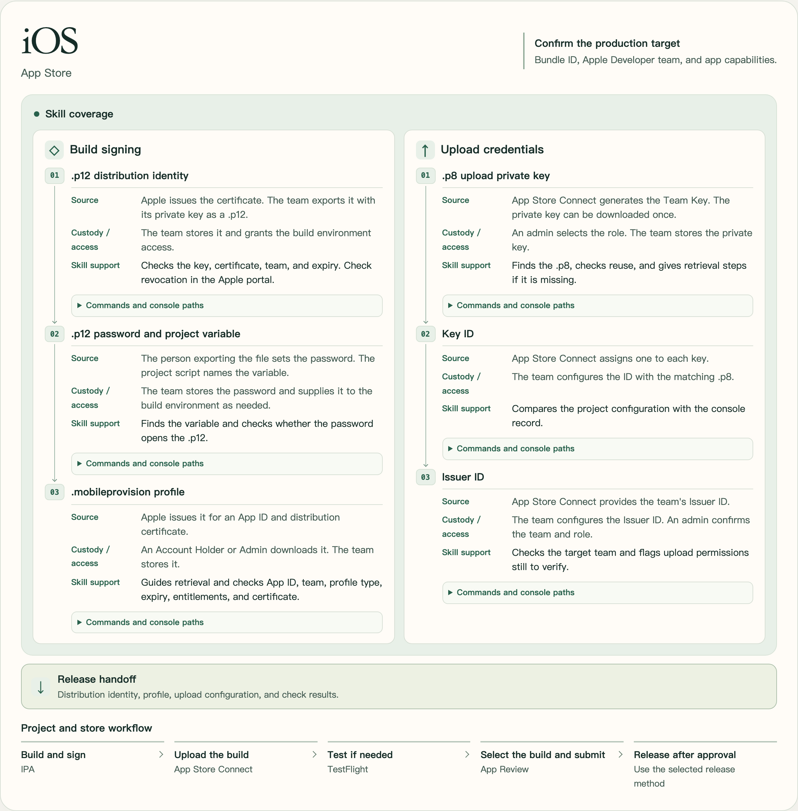
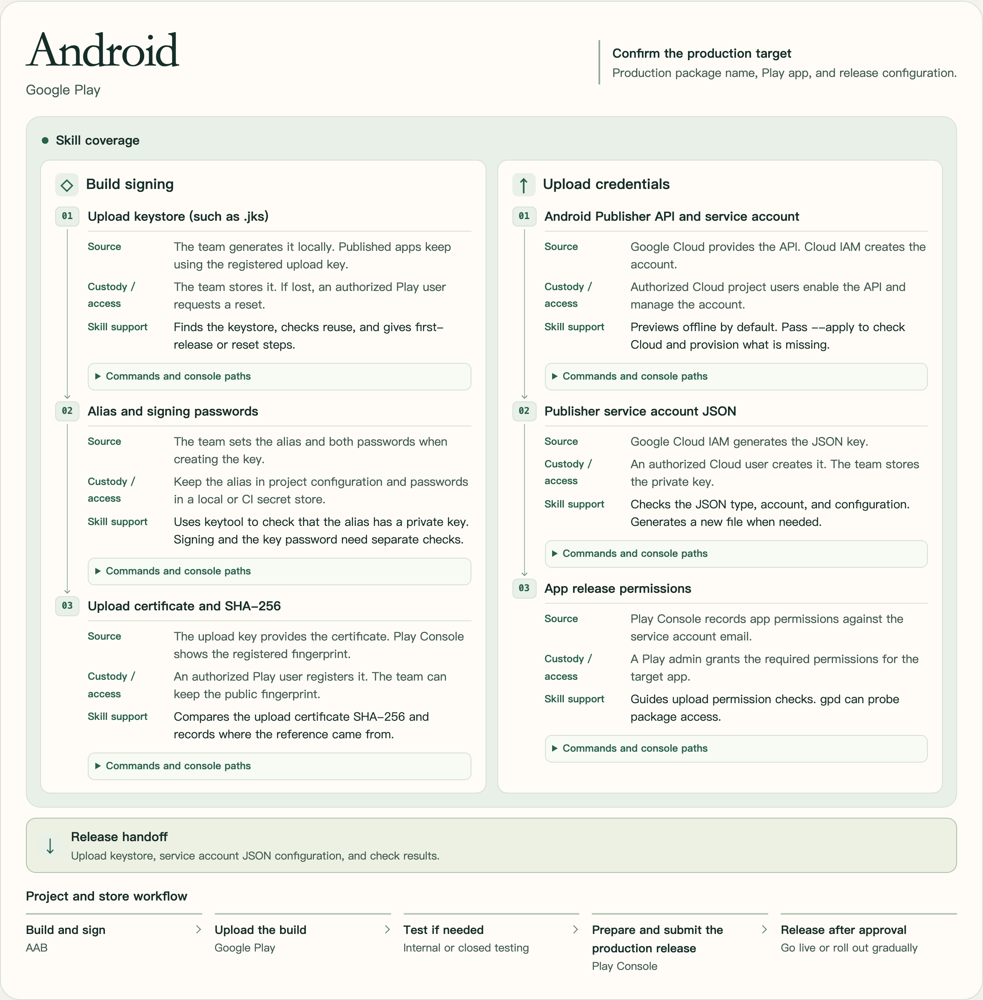

# Mobile Store Credentials

**English** | [中文简体](README.zh_CN.md)

`mobile-store-credentials` is an agent skill for preparing iOS and Android release credentials when onboarding an app, migrating a build setup, or updating an existing store listing. It checks what the project expects, identifies which credentials can be reused, and lists missing items, configuration variables, and next steps.

- **iOS** — Distribution identities (`.p12`), App Store provisioning profiles, and App Store Connect Team Keys (`.p8`). [iOS reference](references/ios.md)
- **Android** — Upload keystores, upload certificate fingerprints, and Google Play publisher service accounts. [Android reference](references/android.md)

## Install

Run from your app repository to install for Codex in that project.

```sh
npx skills add hydra1983/mobile-store-credentials --skill mobile-store-credentials --agent codex
```

Add `--global` to make the skill available across projects. See the [Skills CLI reference](https://github.com/vercel-labs/skills/blob/main/docs/commands.md) for other supported agents and installation options.

## Use in Codex

Open your app repository in Codex and mention `$mobile-store-credentials` in a prompt. Use relative paths and app identifiers to identify the release target. Keep secret values out of the prompt.

**Check iOS credentials after a Bundle ID change**

```text
$mobile-store-credentials Check the production iOS release for apps/mobile
with Bundle ID com.example.fieldnotes. We have a distribution certificate
from another app on the same Apple Developer team. Check what can be reused,
what provisioning profile we need, and what upload permissions remain
unverified. Use read-only checks and dry-runs.
```

**Check signing for an existing Google Play listing**

```text
$mobile-store-credentials Review the Android release for com.example.fieldnotes.
Compare the configured upload keystore with the upload certificate fingerprint
in our release configuration. Locate the publisher service account configuration
and list any permissions to verify in Play Console. Use read-only checks.
```

The skill reports local findings and lists any platform permissions that still need confirmation. Its instructions are in [SKILL.md](SKILL.md).

## Release flows

The diagrams mark where the skill helps prepare signing and upload credentials, who supplies or authorizes them, and where the project takes over the release.

The interactive HTML includes commands and console paths. Download it from GitHub and open it in a browser to expand the operation steps. [Interactive release flows in English](docs/release-flow/mobile-release-flow.html)

### iOS



### Android



## Check iOS signing from the command line

This repository includes a read-only [iOS signing checker](scripts/check-ios-signing.py) for App Store profiles and P12 distribution identities. It runs with Python 3 and OpenSSL and works independently of Codex. See [the command and expected results](references/ios.md#run-the-local-signing-checker).

## Prepare or check a Google Play publisher credential

Run the [standalone preparation script](scripts/prepare-google-play-credentials.sh) with Bash. From a checkout of this repository, preview the setup with generic project and account IDs.

```sh
bash scripts/prepare-google-play-credentials.sh \
  --project example-mobile --service-account play-publisher \
  --key-path ./credentials/google-play/publisher.json --dry-run
```

You can copy the script into another project and run it from that project's root. The default is an offline dry-run. Use `--apply` to make the planned Cloud changes with your active `gcloud` login. Apply also requires Python 3. Use a private, Git-ignored destination for the JSON and grant the service account access to the target app separately in Play Console. [Android setup and recovery](references/android.md#prepare-a-publisher-credential-with-gcloud)

If you already have a service-account JSON, you can optionally check access to the target package with [gpd](https://github.com/dl-alexandre/Google-Play-Developer-CLI). Set `PLAY_SERVICE_ACCOUNT_JSON` to your local credential file and replace the example package.

```sh
gpd auth check \
  --key-path "${PLAY_SERVICE_ACCOUNT_JSON:?Set the service-account JSON path}" \
  --package com.example.fieldnotes --store-tokens never --output json
```

This online probe creates an uncommitted Play edit and attempts to delete it. Run it when that temporary edit is authorized, and check the result for cleanup errors. Verify upload and release permissions separately. For offline or strict read-only checks, use `gpd auth check --help` to inspect the command.

## Upstream references

- The iOS guide follows the sequence of checking the Bundle ID and capabilities, selecting a signing certificate, and obtaining a matching provisioning profile. [`asc-signing-setup` by rorkai](https://github.com/rorkai/app-store-connect-cli-skills/blob/main/skills/asc-signing-setup/SKILL.md)
