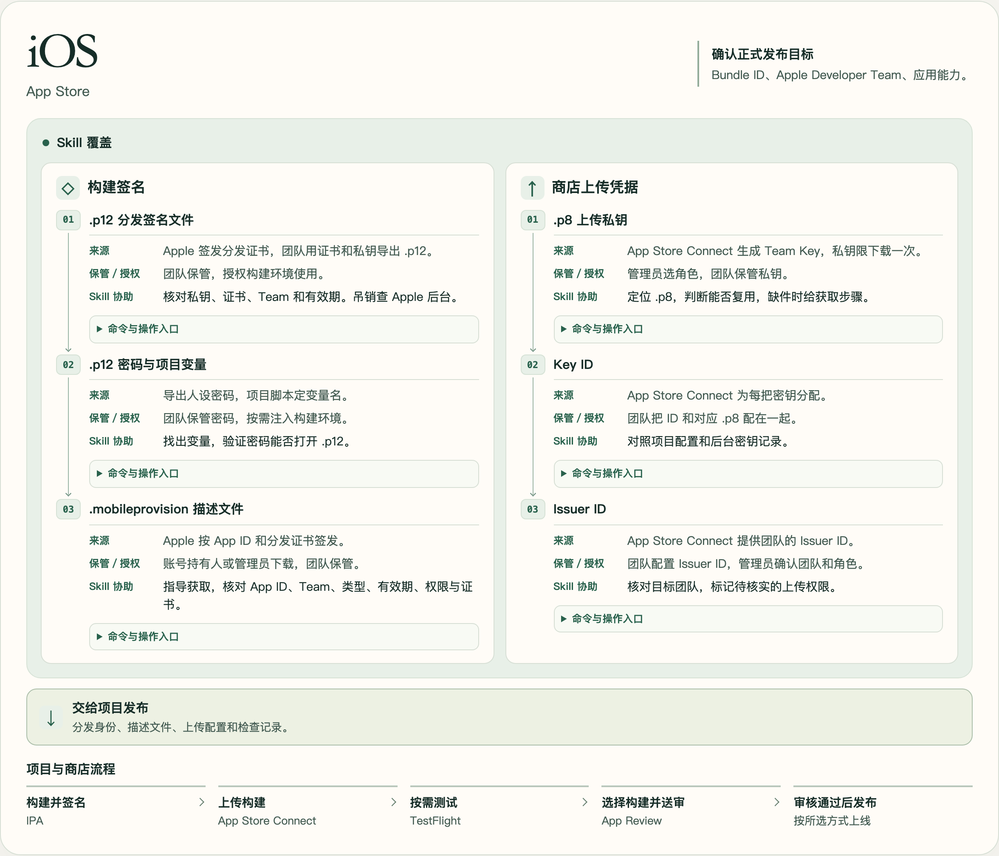
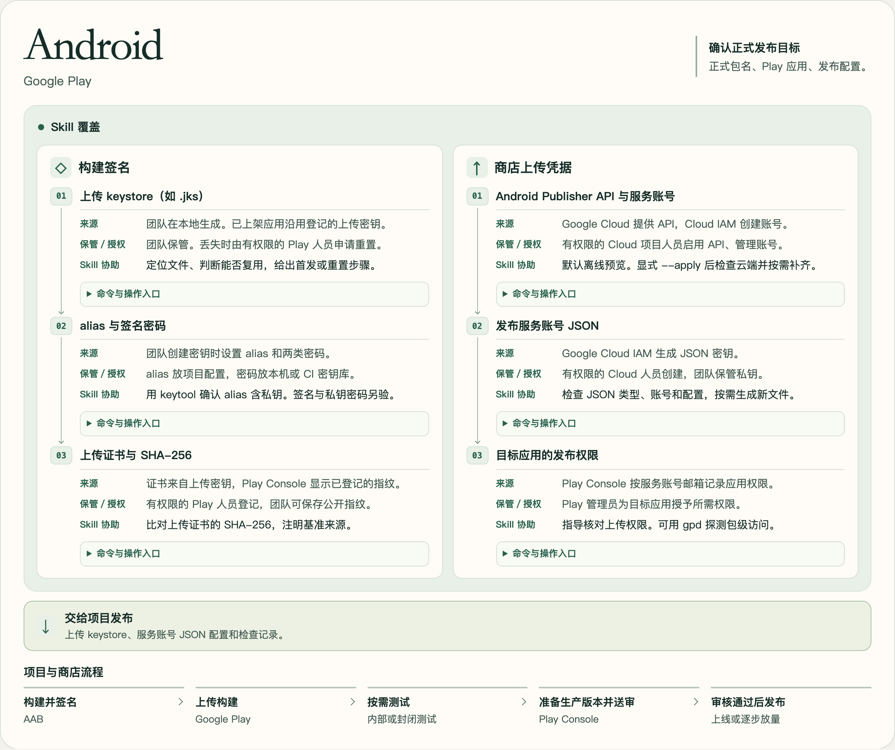

# 移动应用商店发布凭据

[English](README.md) | **中文简体**

`mobile-store-credentials` 帮你准备 iOS 和 Android 的商店发布凭据，适用于新 App 接入、构建迁移和已有 App 更新。它会根据项目的正式发布配置，找出可复用和缺失的凭据，列出需要的变量和下一步。

- **iOS** — 分发签名文件（`.p12`）、App Store 描述文件和 App Store Connect Team Key（`.p8`）。[iOS 指南（英文）](references/ios.md)
- **Android** — 上传 keystore、上传证书指纹和 Google Play 发布服务账号。[Android 指南（英文）](references/android.md)

## 安装

在 App 仓库中运行以下命令，为当前项目安装 Codex Skill。

```sh
npx skills add hydra1983/mobile-store-credentials --skill mobile-store-credentials --agent codex
```

加上 `--global` 可在多个项目中使用。其他支持的 Agent 和安装选项见 [Skills CLI 文档](https://github.com/vercel-labs/skills/blob/main/docs/commands.md)。

## 在 Codex 中使用

在 Codex 打开 App 仓库，在提示中使用 `$mobile-store-credentials`。用相对路径、Bundle ID 或包名指定发布目标。密码和私钥通过本机或 CI 配置提供。

**更换 Bundle ID 后检查 iOS 凭据**

```text
$mobile-store-credentials 检查 apps/mobile 的 iOS 正式发布配置。
Bundle ID 为 com.example.fieldnotes。我们有同一 Apple Developer Team
下另一个 App 的分发证书。请确认可复用的凭据、需要补齐的描述文件
和待核实的上传权限。只做只读检查和 dry-run。
```

**检查已上架 Android 应用的签名**

```text
$mobile-store-credentials 检查 com.example.fieldnotes 的 Android 发布配置。
将上传 keystore 与发布配置里的上传证书指纹比对，找到发布服务账号配置，
并列出需要在 Play Console 核实的权限。只做只读检查。
```

Skill 会汇报本地检查结果和待核实的平台权限。[Skill 说明（英文）](SKILL.md)

## 发布流程图

图中标出每项凭据由谁提供或授权、Skill 可以协助什么，以及何时交给项目发布。打开 [中文版交互流程图](https://hydra1983.github.io/mobile-store-credentials/release-flow/mobile-release-flow.zh_CN.html)，即可展开查看命令和后台入口。

### iOS



### Android



## 从命令行检查 iOS 签名

[iOS 签名检查器](scripts/check-ios-signing.py) 可只读核对 App Store 描述文件和 P12 分发签名文件。需要 Python 3 和 OpenSSL，可独立运行。[命令与预期结果（英文）](references/ios.md#run-the-local-signing-checker)

## 准备或检查 Google Play 发布凭据

在本仓库根目录运行 [独立准备脚本](scripts/prepare-google-play-credentials.sh)，将示例项目和账号 ID 换成实际值。

```sh
bash scripts/prepare-google-play-credentials.sh \
  --project example-mobile --service-account play-publisher \
  --key-path ./credentials/google-play/publisher.json --dry-run
```

可以把脚本复制到其他项目，从项目根目录运行。默认离线预览。显式使用 `--apply` 才会通过当前登录的 `gcloud` 执行云端变更，此模式还需要 Python 3。JSON 存放在私有且被 Git 忽略的路径，目标应用的权限在 Play Console 单独授予。[Android 准备与恢复步骤（英文）](references/android.md#prepare-a-publisher-credential-with-gcloud)

已有服务账号 JSON 时，可用 [gpd](https://github.com/dl-alexandre/Google-Play-Developer-CLI) 探测目标包名的访问权限。将 `PLAY_SERVICE_ACCOUNT_JSON` 指向本地凭据文件，并替换示例包名。

```sh
gpd auth check \
  --key-path "${PLAY_SERVICE_ACCOUNT_JSON:?Set the service-account JSON path}" \
  --package com.example.fieldnotes --store-tokens never --output json
```

此探测会创建未提交的 Play edit，再尝试删除。获准创建临时 edit 后运行，并检查清理结果。上传和发布权限单独核实。离线或严格只读场景可用 `gpd auth check --help` 查看命令。

## 上游参考

- iOS 指南采用先核对 Bundle ID 和应用能力、再选签名证书和匹配描述文件的顺序。[rorkai 的 `asc-signing-setup`](https://github.com/rorkai/app-store-connect-cli-skills/blob/main/skills/asc-signing-setup/SKILL.md)
